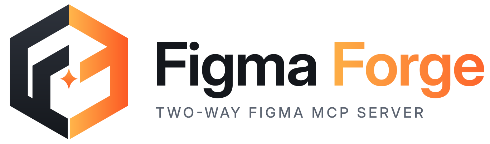
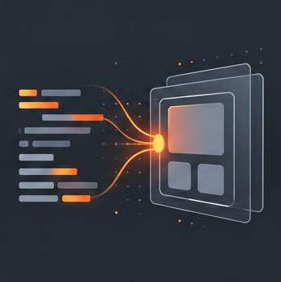
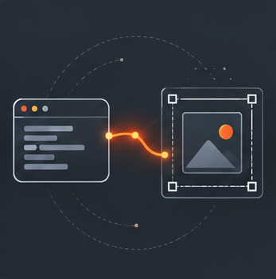

<h1 align="center">
  <picture>
    <source media="(prefers-color-scheme: dark)" srcset=".github/assets/logo-full-dark.svg">
    
  </picture>
</h1>

A two-way Figma MCP server. A coding agent reads a Figma file as structured design context and edits the canvas through a Figma plugin.

<p align="center">
  
  
  
</p>

Figma Forge is a hard fork of [Figwright](https://github.com/awdr74100/figwright) (MIT, © Roya).

## Setup

You need Node.js 24.11+ and the Figma desktop app.

1. Add the server to your MCP client:

   ```bash
   claude mcp add figma-forge -- npx -y @figma-forge/mcp@latest
   ```

   Other clients take the same command in their config:

   ```json
   {
     "mcpServers": {
       "figma-forge": {
         "command": "npx",
         "args": ["-y", "@figma-forge/mcp@latest"]
       }
     }
   }
   ```

2. Start your MCP client once. The server copies the plugin to `~/Figma Forge/`.
3. In Figma, go to **Plugins → Development → Import plugin from manifest…** and pick `~/Figma Forge/manifest.json`. You do this once; later server versions update the files in place.
4. Run **Figma Forge** in your file and wait for the panel to show **Connected**.
5. Ask your agent to run `ping`. If the plugin is not connected, `ping` says what is missing.

The relay listens on `127.0.0.1:3056`. Set `FIGMA_FORGE_PLUGIN_DIR` to copy the plugin somewhere else.

## Development

Build from source with pnpm 12:

```bash
pnpm install && pnpm build
```

Point your MCP client at `node /path/to/figma-forge/packages/server/dist/index.mjs`, and import `packages/plugin/manifest.json` in Figma so plugin rebuilds take effect without a version bump.

Run the same checks CI runs:

```bash
pnpm typecheck && pnpm lint && pnpm format:check && pnpm knip && pnpm build && pnpm test
```

After you change the server, rebuild and reconnect your MCP client. After you change the plugin, rebuild and run the plugin again.

Conventions are in [AGENTS.md](./AGENTS.md).

## License

MIT. See [LICENSE](./LICENSE).
